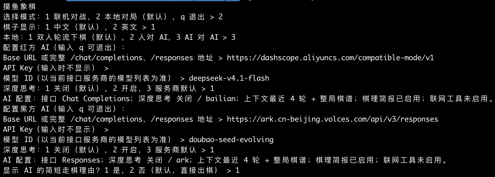
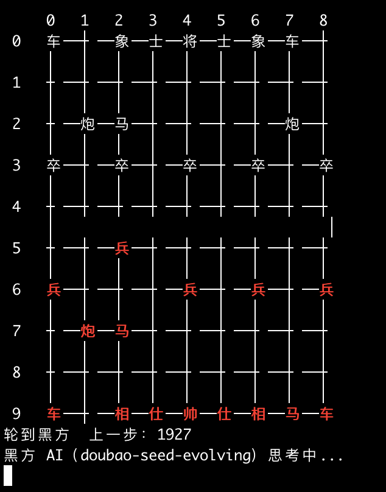
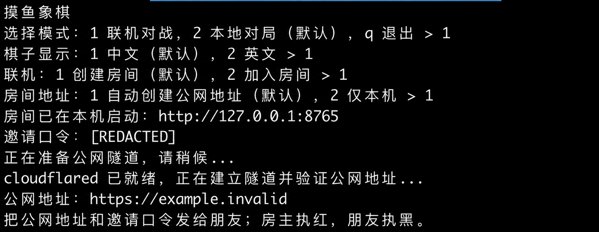
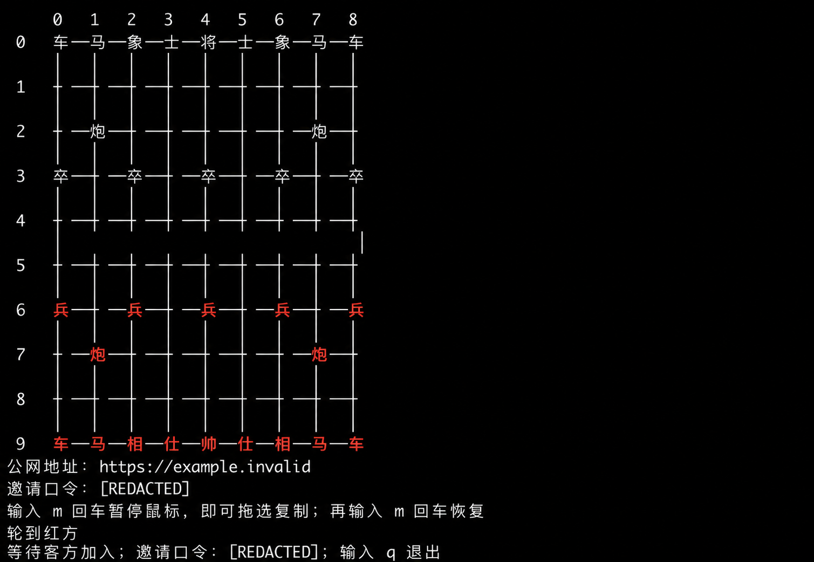

# 摸鱼象棋 · Slacker Xiangqi

在终端里和朋友下象棋，也可以让两个大模型对弈。

使用 Go 编写，提供类似 `top` 的固定棋盘面板、鼠标点选和键盘走棋。支持本地双人、人对 AI、AI 对 AI，以及通过临时公网隧道邀请朋友联机。无需搭建独立的公共游戏服务器。

## 功能

| 功能 | 说明 |
| --- | --- |
| 本地对局 | 两个人在同一个终端轮流下棋 |
| 好友联机 | 房主创建房间，朋友通过地址和邀请口令加入 |
| 自动公网隧道 | 可由游戏管理 Cloudflare Quick Tunnel 的启动和清理 |
| 人机与双 AI | 两方可分别配置服务商、模型和 API Key |
| 接口兼容 | Chat Completions 与 Responses，完整地址自动识别 |
| 深度思考 | 关闭、开启、服务商默认；适配百炼、DeepSeek、豆包方舟的参数 |
| 操作方式 | 鼠标点棋子再点落点；也可输入坐标或棋子编号 |
| 显示 | 中文或英文字母；双方配置独立，执黑时棋盘自动翻转 |

> AI 是通用大模型，不是专用象棋引擎。程序校验规则，实际着法由模型选择，可能出现布局失误、送子或无意义重复。深度思考、历史和棋理提示不保证提升棋力。

## 界面预览

### AI 对弈

下面展示两个模型的配置流程和对弈画面。截图中的 API Key 输入为隐藏状态，模型名称仅为示例，不代表当前服务商一定提供该型号。

<details>
<summary>查看双 AI 配置</summary>



</details>



### 联机房间

创建临时公网房间，并在棋盘下方显示连接信息。公开截图中的真实临时地址和邀请口令已脱敏，不能用于加入房间。





## 快速开始

需要 **Go 1.23 或更高版本**。项目没有第三方 Go 包依赖。

```sh
git clone https://github.com/nameisasia-wq/slacker-xiangqi.git
cd slacker-xiangqi
go run ./cmd/moyu
```

根据菜单选择：

- **联机对战**：创建或加入房间。
- **本地对局**：双人轮流、人对 AI、AI 对 AI。

中文为引导菜单默认显示。游戏可在普通终端或 VS Code 集成终端运行；推荐使用支持 ANSI 颜色和 xterm SGR 鼠标事件的 macOS / Linux 终端。终端不支持鼠标时可使用键盘；Windows 的终端交互与鼠标行为需要自行验证。

编译为独立程序后无需安装 Go：

```sh
go build -o moyu ./cmd/moyu
./moyu
```

## 怎么下棋

- **鼠标**：点击己方棋子选中，再点击目标位置走棋或吃子。选中棋子显示金色；暂不支持拖动。
- **直接走棋**：输入 `0605` 回车，表示从 `(0,6)` 走到 `(0,5)`。
- **辅助选棋**：输入 `R2` 或 `车2` 回车，查看落点，再输入两位落点坐标。
- **复制文字**：输入 `m` 回车，暂停鼠标捕获后拖选地址、口令；再次输入 `m` 恢复。
- **退出**：输入 `q` 回车。

坐标横向为 `0–8`，纵向为 `0–9`，横坐标在前。黑方视角旋转 180° 时，边缘坐标也相应倒序；坐标含义保持不变。

| 命令 | 用途 |
| --- | --- |
| `moves` | 查看当前合法着法数量 |
| `moves 06` / `moves 车2` | 查看指定位置或棋子的可走落点 |
| `help` | 操作帮助 |
| `m` | 切换鼠标与文字复制模式 |
| `i` / `t` | 联机时查看邀请口令 / 隧道信息 |
| `q` | 退出当前对局 |

中文棋盘不显示编号，键盘仍可用编号选择。英文棋子红方大写、黑方小写：`G` 将帅、`A` 士仕、`E` 象相、`H` 马、`R` 车、`P` 炮、`B` 兵卒。这是本项目的字母约定。

## 和朋友联机

推荐直接进入菜单，选择「联机对战 → 创建房间 → 自动创建公网地址」。也可使用命令：

```sh
# 房主执红，自动创建隧道
go run ./cmd/moyu host --tunnel --lang zh

# 朋友执黑，将地址替换为房主本次分享的公网地址
go run ./cmd/moyu join --url 'https://YOUR-ROOM.trycloudflare.com' --lang zh
```

客方按提示输入邀请口令。房主需要保持游戏运行；房主退出后，临时隧道随之关闭。双方显示语言互不影响，客方棋盘为黑方在下。对手加入或退出时会显示相应状态。

本机自测可以开两个终端，不需要隧道：

```sh
# 终端一
go run ./cmd/moyu host --lang zh

# 终端二
go run ./cmd/moyu join --url http://127.0.0.1:8765 --lang zh
```

局域网房主可用 `host --listen 0.0.0.0:8765`，客方使用房主局域网 IP；请限制端口的访问范围。默认只监听本机，不会直接将游戏端口开放到公网。

### cloudflared 如何处理

`--tunnel` 使用 [Cloudflare Quick Tunnel](https://developers.cloudflare.com/tunnel/get-started/quick-tunnels/)，适合临时对局，连接质量取决于网络和第三方服务的可达性。

游戏依次查找：可执行文件旁的 `cloudflared`、系统 `PATH`、游戏用户缓存。找不到时尝试从官方源下载固定版本，显示进度并验证 SHA-256，存入系统用户缓存下的 `moyu-xiangqi/cloudflared` 供下次复用。Linux 优先使用 Cloudflare 软件包源，其他平台及后备来源为 GitHub Releases。

如需指定已有程序：

```sh
go run ./cmd/moyu host --tunnel --tunnel-bin /path/to/cloudflared
```

隧道程序不是 Go 包依赖，也没有作为二进制提交到源码仓库。发布包构建脚本会附带匹配平台的程序及其许可证。

## 与 AI 下棋

进入菜单选择「本地对局 → 人对 AI」或「AI 对 AI」，依次填写：

1. 服务商 Base URL 或完整接口地址。
2. 该服务商的 API Key，交互输入不回显。
3. 控制台提供的模型 ID。
4. 深度思考模式；再选择是否显示简短走棋理由。

双 AI 对弈时，两方分别配置，可使用不同服务商和协议。人对 AI 可选择自己执红或执黑。**目前 AI 自动走棋仅用于本地对局，联机 `host/join` 由真人操作。**

### 接口地址

| 输入 | 程序使用的协议 |
| --- | --- |
| `https://api.deepseek.com` | 默认补成 `/chat/completions` |
| `https://api.deepseek.com/chat/completions` | Chat Completions |
| `https://api.deepseek.com/responses` | Responses |
| `https://dashscope.aliyuncs.com/compatible-mode/v1` | 默认补成 `/chat/completions` |
| `https://ark.cn-beijing.volces.com/api/v3/responses` | Responses |

第三方兼容地址也按完整路径识别。基础地址默认使用 Chat；要用 Responses 请填写完整 `/responses`。接收地址并不保证模型权限、版本或服务商实现一定兼容。

### 深度思考与上下文

- 深度思考统一选择 `off`、`on`、`default`。已识别的可控接口默认关闭；未识别的接口默认沿用服务商设置，可手动指定思考协议。
- 自动适配百炼、DeepSeek 官方及豆包方舟的开关。部分型号不支持关闭思考，最终以服务商支持情况为准。
- 已适配且支持轻量力度的模型，开启思考时默认请求 `low`；百炼 `deepseek-v4-pro` 使用其支持的 `high`。
- 每步携带最新文字棋盘、完整实际棋谱、最近 **4 轮己方对话** 和阶段目标。双方上下文独立，新局清空。
- 固定的棋理简报介绍规则、开局体系、中残局思路，见 [primer.go](internal/ai/primer.go)。这是参考资料，不是训练模型。
- 不提供联网搜索工具。只解析最终走棋内容，不保存原始推理过程；简短理由不等于完整思考过程。

关闭思考默认每步等待上限为 90 秒，其他模式 180 秒。已适配协议的思考模式默认 Token 上限为 16384；有的服务商将推理和正文合并计算。Token 耗尽时保留棋局，输入 `1` 增大预算重新请求，`2` 关闭思考重试，`q` 退出。重试可能再次计费。流式断开或回复未完成时不会执行截断的走法。

### 命令行示例

菜单不需要配置环境变量。自动化运行时可以使用以下变量，均不需要修改源码：

| 环境变量 | 用途 |
| --- | --- |
| `MOYU_RED_API_KEY` | 红方模型 Key |
| `MOYU_BLACK_API_KEY` | 黑方模型 Key |
| `OPENAI_API_KEY` | 两方 Key 的公共后备值 |
| `MOYU_JOIN_TOKEN` | 可选的联机邀请口令；默认交互输入 |

Bash / Zsh 可隐藏读取 Key，再运行人机对局：

```sh
read -rs MOYU_BLACK_API_KEY
export MOYU_BLACK_API_KEY
go run ./cmd/moyu play --lang zh \
  --black-url https://api.deepseek.com/responses \
  --black-model deepseek-flash \
  --thinking on
```

模型名仅为服务商接口示例，请核对自己的控制台。双 AI 使用 `--red-model`、`--black-model`，并分别填写 URL 和 Key。

常用参数：

| 参数 | 用途 |
| --- | --- |
| `--lang zh` / `--lang en` | 本端棋子显示语言 |
| `--red-url` / `--black-url` | 每方接口地址 |
| `--red-model` / `--black-model` | 每方模型，留空为人类 |
| `--thinking off\|on\|default` | 统一思考模式 |
| `--red-thinking` / `--black-thinking` | 分别覆盖模式 |
| `--red-thinking-api` / `--black-thinking-api` | `auto`、`bailian`、`deepseek`、`ark` |
| `--thinking-effort low\|high\|max` | 已适配型号的推理力度 |
| `--ai-timeout 300s` | 每步总等待上限 |
| `--ai-max-tokens 32768` | 自定义输出 / 推理预算 |
| `--explain` | 显示模型给出的简短理由 |
| `--strict-ai` | 不提供候选走法列表，观察模型能否自行给出正确走法 |
| `--max-plies 200` | 双 AI 最大半回合数 |
| `--games 2` | 双 AI 多局对弈并交换红黑 |

具体参数以 `go run ./cmd/moyu play -h`、`host -h`、`join -h` 为准。

## 构建和测试

```sh
go test ./...
go vet ./...

# 两个真实进程完成本机联机对局
python3 scripts/accept_local.py --host-lang en --guest-lang zh
```

Linux x86-64 交叉编译：

```sh
GOOS=linux GOARCH=amd64 CGO_ENABLED=0 go build -o moyu-linux-amd64 ./cmd/moyu
```

需要 Python 3 来制作包含 `cloudflared` 的发布包：

```sh
python3 scripts/package_release.py --target linux/amd64
# 或构建全部支持目标
python3 scripts/package_release.py --all
```

发布包位于被 Git 忽略的 `dist/`，包名沿用 `moyu-xiangqi-*`。源码仓库名称是 `slacker-xiangqi`，Go 模块、游戏命令和缓存目录沿用 `moyu-xiangqi` / `moyu`，不影响运行。发布脚本的目标构建成功不代表相应系统的终端行为已完成实机验收。

## 隐私与公开贡献

- 交互式输入的 API Key 只供本机调用模型使用，程序不主动保存为配置文件，也不发送给联机对手。AI 对局的棋盘和对话会发送给所配置的模型服务商。
- `.gitignore` 排除 `.env`、常见私钥 / 凭据文件、本地配置、缓存、日志、对局记录、编译产物和发布包。
- `.gitignore` 只能保护未跟踪的文件，不能删除已经提交的秘密。提交前查看 `git status` 与 `git diff --cached`，示例中使用占位值。
- 邀请口令相当于加入房间的凭据，请只私下分享。截图公开前应遮盖口令、临时地址、Key 和个人信息；本文截图里的连接信息已处理。
- 报告问题时请提供系统、终端、复现步骤和脱敏日志，不要粘贴 API Key、房间口令或 SSH 私钥。

## 已知范围

已实现常用规则，包括蹩马腿、塞象眼、炮架、过河、九宫、将帅照面、被将军时的走法限制和无棋可走判负。尚未实现重复局面 / 长将长捉裁决、悔棋、棋谱保存和断线重连。

项目仍在迭代，欢迎通过 Issues 反馈问题，或提交 Pull Request。

## 代码结构

```text
cmd/moyu/           交互菜单、终端输入与显示、联机和 AI 对局入口
internal/xiangqi/   棋盘状态、走法规则、中文和英文显示
internal/netplay/   房间、邀请口令、同步与退出通知
internal/ai/        Chat / Responses、服务商参数、对话上下文
internal/tunnel/    cloudflared 查找、下载校验与进程管理
scripts/           自动验收和发布包构建脚本
docs/images/       README 使用的公开截图
third_party/       第三方许可证
```

## 开源许可

本项目使用 [MIT License](LICENSE)。发布包中的 `cloudflared` 使用 Apache-2.0，详见 [第三方声明](THIRD_PARTY_NOTICES.md)及其[许可证](third_party/cloudflared/LICENSE)。
